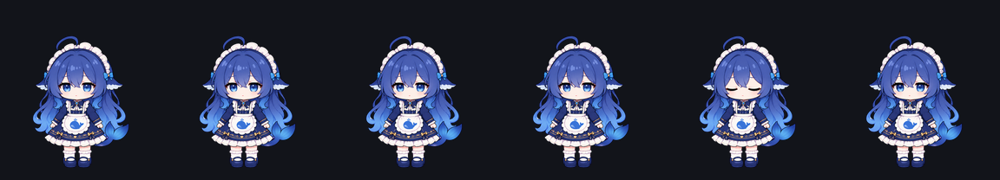
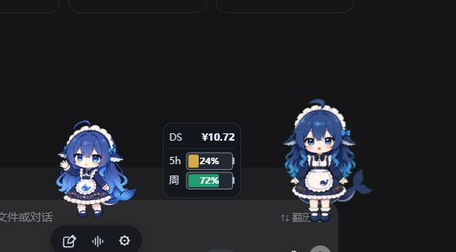

# DeepSeek Whale Girl · DSH Pet and Quota Kit

One repository, two independently installable parts:

| Location | What | Result |
| --- | --- | --- |
| **Repository root** | Pet pack: the `DeepSeek Whale Girl` character | A blue-haired whale girl in DSH |
| **[`quota/`](quota/)** | Companion plugin: small DS + balance/quota panel | A resident companion with balance and subscription quota |

They work together or separately. The companion draws itself from this very pet's
atlas, so installing both gives the complete experience.

---

# Part 1 — Pet pack (repository root)



| Field | Value |
| --- | --- |
| Pet ID | `custom:deepseek-whale-v2` |
| Spritesheet | 1536 × 2288, 8 × 11, 192 × 208 per cell, RGBA |
| Protocol | `spriteVersionNumber: 2` |
| Artwork by | YunYueSama |

## Dependencies

| Plugin | Required? | Role |
| --- | --- | --- |
| `@michengai/dsh-codex-pet` | **Yes** | Renders pets and provides the pet settings UI |
| `@michengai/dsh-codex-ui` | **No** | A UI skin; unrelated to pet rendering |
| `@linxin666/dsh-pet` | No | A separate pet system; no conflict |

**About codex-UI:** you do not need it. This package is a pet asset pack plus a thin
installer; the character is rendered straight from the spritesheet. Searching the `lib/`
output of `@michengai/dsh-codex-pet` 1.0.2 finds no `codex-ui` reference.

## Install

```sh
dsh plugin add <this repository>
```

The pet is written into the pet library on first activation; an existing folder is never
overwritten. Then refresh the DSH pet settings and pick “DeepSeek 鲸鱼娘”.

Without the plugin:

```sh
git clone <this repository>
node scripts/install.mjs            # install; leave an existing copy alone
node scripts/install.mjs --force    # overwrite
```

Or copy `pets/deepseek-whale-v2/` into:

- Windows: `%USERPROFILE%\.dsh\codex-pet\pets\deepseek-whale-v2\`
- macOS / Linux: `~/.dsh/codex-pet/pets/deepseek-whale-v2/`

---

# Part 2 — Companion plugin (`quota/`)

Full details in **[quota/README.md](quota/README.md)**.



It provides the companion, the `DS ¥` / `5h` / `week` batteries, task cards, settings, and
an **optional** always-on-top desktop window (requires editing DSH Desktop files; pinned to
`2.0.18`).

| Dependency | Required |
| --- | --- |
| `@linxin666/dsh-pet` | **Yes** |
| Pet `deepseek-whale-v2` (the root package here) | **Yes** |
| `@linxin666/dsh-usage` | Suggested (balance) |
| `@eddyskywalker/dsh-chatgpt-subscription` | Suggested (5h / week) |
| `@michengai/dsh-codex-ui` | **No** |

Because it lives in a subdirectory, point the plugin manager at that subpath:

```sh
git clone <this repository>
dsh plugin add link:<clone>/quota
```

Read [quota/README.md](quota/README.md) before installing the desktop window: it backs up
files, verifies the version, and supports byte-exact `--restore`.

---

# License and attribution

- **Character artwork**: by YunYueSama, <https://github.com/YunYueSama/codex-deepseek-pet>,
  under the “大肥鱼项目署名许可 1.0”: use, modify, share and commercial use allowed,
  **provided the author and repository are credited and the full license is retained when
  redistributing**. See [LICENSE](LICENSE) and [ASSET_LICENSE.md](ASSET_LICENSE.md).
  Not an official DeepSeek or OpenAI release.
- **`quota/` code**: MIT, see [quota/LICENSE](quota/LICENSE). It bundles no character
  artwork; it reads the pet atlas already installed on your machine.

# Verification

- Pet spritesheet measured at 1536×2288, RGBA, transparent corners, matching the protocol grid.
- Companion plugin: 30 tests pass, including desktop-installer sandbox tests (version
  refusal, idempotency, take-over guard, byte-exact restore).
- **Not verified**: the full “plugin manager install → pet / companion appears” path on a
  clean third-party machine; the desktop window was only validated on DSH Desktop `2.0.18`.
